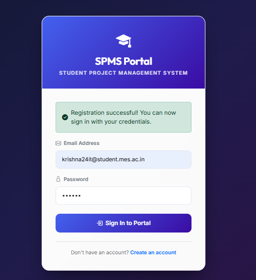
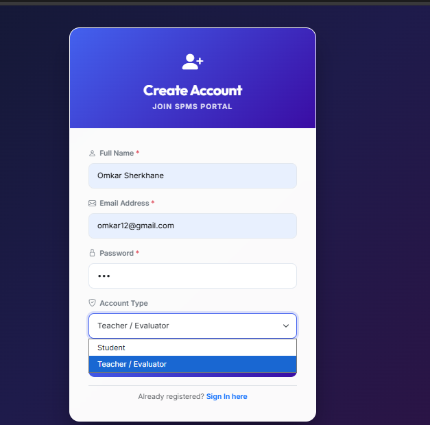

# STUDENT PROJECT MANAGEMENT SYSTEM (SPMS)
## Enterprise Application Development (EAD) Project Report & Documentation

---

# 1. Project Title & Overview

- **Project Name:** Student Project Management System (SPMS)
- **Domain:** Enterprise Web Application Development / Academic Workflow Automation
- **Architecture:** Layered Enterprise Model-View-Controller (Spring MVC + Hibernate ORM)
- **Runtime Environment:** Java JDK 17, Embedded Apache Tomcat 9.0.85
- **Persistence:** Multi-mode Relational Engine (Oracle / MySQL 8.2 / Persistent H2)

---

# 2. Certificate

```
========================================================================================
                                     CERTIFICATE
========================================================================================

This is to certify that the project entitled:

                    "STUDENT PROJECT MANAGEMENT SYSTEM (SPMS)"

is a bona fide record of independent work carried out by:

    Student Name   :  __________________________________________________
    Roll Number    :  __________________________________________________
    Class / Sem    :  B.Sc. / B.Tech / MCA (Semester: ________)
    Academic Year  :  2025 - 2026

in partial fulfillment of the requirements for the degree and coursework evaluation in:
                 ENTERPRISE APPLICATION DEVELOPMENT (EAD)

under our supervision and guidance. To the best of our knowledge, the matter embodied 
in this project has not been submitted to any other University or Institution for the 
award of any degree, diploma, or certificate.


_____________________________                         _____________________________
   Project Guide / Faculty                                Head of Department
      Internal Examiner                                    External Examiner


Date:  ____ / ____ / ________
Place: ______________________
========================================================================================
```

---

# 3. Introduction (About Project)

### 3.1 Project Overview
The **Student Project Management System (SPMS)** is a web-based Enterprise Application developed to streamline, monitor, and regulate student academic project submissions, evaluations, and deadlines. Designed as part of the **Enterprise Application Development (EAD)** curriculum, the platform digitizes the academic submission workflow, replacing unorganized manual submissions (via email or physical files) with a centralized, automated portal.

The application follows an enterprise-grade **Multi-Tier Architecture** utilizing **Spring MVC** and **Hibernate ORM**, ensuring separation of concerns, transactional consistency, role-based access control, and automated deadline enforcement.

### 3.2 Problem Statement & Motivation
In typical academic institutions:
- **Students face confusion** regarding project requirements, submission channels, and deadlines.
- **Faculty members struggle** with manual tracking, fragmented email attachments, and late submissions.
- **Lack of centralized transparency** prevents real-time tracking of submission statuses (`PENDING`, `APPROVED`, `REJECTED`).

SPMS solves these issues by providing a unified environment where students submit project details alongside documentation (PDF files), and teachers assess submissions, enforce strict cutoff dates, and approve or reject submissions in real time.

### 3.3 Objectives of the System
- **Centralized Submissions:** Allow students to register and submit academic project abstracts, descriptions, subject classifications, and PDF documentation files.
- **Deadline Management & Automated Enforcement:** Enable faculty to schedule subject-wise deadlines; automatically close submissions when the due date passes.
- **Role-Based Workflows:** Segregate interfaces and capabilities between Students (`ROLE_STUDENT`) and Faculty/Teachers (`ROLE_TEACHER`).
- **Review and Evaluation Pipeline:** Provide faculty with statistical dashboards to inspect submissions, download project documentation, and update project statuses (`PENDING`, `APPROVED`, `REJECTED`).
- **Resilient Zero-Friction Deployment:** Incorporate an embedded application server and an automatic multi-mode database engine (Oracle / MySQL with persistent file-based H2 fallback).

### 3.4 Key Functional Modules
1. **Authentication & Session Module:** Supports student and faculty login/registration, password verification, and session state maintenance.
2. **Student Workspace:** View enrolled submissions, check approval statuses, and observe upcoming subject deadlines.
3. **Submission Gatekeeper:** Validates PDF uploads, title length, description constraints, and rejects uploads if the submission window has elapsed.
4. **Faculty Dashboard & Grading:** Metric summary cards, complete submission listing, documentation streaming, and immediate status toggles.
5. **Deadline Scheduling Console:** Configure submission closing datetimes per subject with instant system-wide cutoff propagation.

---

# 4. Tools & Techniques Used

### 4.1 Programming Language & Platform
- **Java (JDK 17 LTS):** Platform choice offering modern language features, strong typing, robust concurrency, and high memory efficiency.
- **Jakarta / Java EE APIs:** Servlet 4.0 API, JSP 2.3 API, JSTL 1.2, and Bean Validation API (`javax.validation`).

### 4.2 Architecture & Design Patterns
- **Model-View-Controller (MVC) Pattern:** Decouples presentation logic, business logic, and database persistence.
  - *Model:* JPA/Hibernate entity classes mapping database tables.
  - *View:* Dynamic JavaServer Pages (JSP) using JSTL tags.
  - *Controller:* Spring MVC controllers handling HTTP requests and model binding.
- **Layered Enterprise Architecture:**
  1. *Presentation Layer:* JSP views rendered via Spring `DispatcherServlet`.
  2. *Controller Layer:* Spring MVC Controllers (`@Controller`, `@RequestMapping`).
  3. *Service Layer:* Transactional business logic (`@Service`, `@Transactional`).
  4. *Data Access Layer (DAO):* Hibernate repositories (`@Repository`, Hibernate `SessionFactory`).
  5. *Data Model / Domain Layer:* JPA Entities (`@Entity`, `@Table`).
- **Dependency Injection & Inversion of Control (IoC):** Spring-managed component lifecycle and autowiring (`@Autowired`).
- **Data Access Object (DAO) Pattern:** Encapsulates persistence logic behind clean interfaces.

### 4.3 Database & Persistence Techniques
- **Multi-Engine Relational Support:**
  - **Oracle Database:** Configured via `ojdbc8` driver on port 1521.
  - **MySQL 8.2 (Primary RDBMS):** Configured with `com.mysql.cj.jdbc.Driver` on port 3306.
  - **H2 Persistent Database (Adaptive Fallback):** Zero-configuration embedded database activating automatically if an external DB server is offline.
- **Smart Connection Probing:** Uses low-latency network socket discovery (`InetSocketAddress`) in `AppConfig.java` to detect database availability at boot time.
- **Hibernate ORM 5.6.15.Final:** Automatic DDL management (`hibernate.hbm2ddl.auto = update`), transactional session caching, and secure parameterized HQL queries.

### 4.4 Presentation & UI Techniques (Design Description)
Instead of relying on heavy frontend frameworks, the user interface is developed cleanly using modern web standards:
- **JSP & JSTL (JavaServer Pages Standard Tag Library 1.2):** Server-side view rendering using `<c:if>`, `<c:forEach>`, and `<c:choose>` tags for conditional status banners, loops, and session checks.
- **Bootstrap 5.3.3 Grid & Components:** Responsive containers, cards, tables, modal dialogs, and button groups ensuring mobile and desktop responsiveness.
- **Bootstrap Icons 1.11.3:** Vector SVG icons indicating actions (file download, status checkmarks, clock deadlines, graduation cap branding).
- **Glassmorphism & Custom Theming:** Custom CSS styles implementing frosted-glass container backgrounds, gradient button styling, rounded corners (`border-radius: 1.25rem`), and drop-shadows.
- **Typography:** Google Web Fonts using `Inter` for crisp body copy and `Outfit` for display typography.

### 4.5 Application Server & Build Tools
- **Embedded Apache Tomcat 9.0.85:** Boots the web context programmatically without requiring an external container.
- **Apache Maven 3.x:** Dependency resolution, lifecycle build phases, and WAR artifact compilation.
- **Zero-XML Java Config:** Fully programmatic setup using `AbstractAnnotationConfigDispatcherServletInitializer`.

---

# 5. Code (Core Java Enterprise Logic)

> *Note: In accordance with project documentation standards, raw UI markup and CSS styling code are omitted; the presentation layer is detailed in Section 4.4 and Section 5.5. Only the core enterprise backend architecture is provided below.*

### 5.1 Configuration Tier

#### `AppConfig.java`
*Configures Spring MVC, Hibernate SessionFactory, View Resolvers, Multipart file upload handlers, and dynamic dual-mode DataSource (Oracle / MySQL with H2 fallback).*

```java
package com.spms.config;

import org.springframework.context.annotation.Bean;
import org.springframework.context.annotation.ComponentScan;
import org.springframework.context.annotation.Configuration;
import org.springframework.jdbc.datasource.DriverManagerDataSource;
import org.springframework.orm.hibernate5.HibernateTransactionManager;
import org.springframework.orm.hibernate5.LocalSessionFactoryBean;
import org.springframework.transaction.PlatformTransactionManager;
import org.springframework.transaction.annotation.EnableTransactionManagement;
import org.springframework.web.servlet.ViewResolver;
import org.springframework.web.servlet.config.annotation.EnableWebMvc;
import org.springframework.web.servlet.config.annotation.ResourceHandlerRegistry;
import org.springframework.web.servlet.config.annotation.WebMvcConfigurer;
import org.springframework.web.servlet.view.InternalResourceViewResolver;
import org.springframework.web.servlet.view.JstlView;

import javax.sql.DataSource;
import java.io.File;
import java.net.InetSocketAddress;
import java.net.Socket;
import java.util.Properties;
import java.util.logging.Logger;

@Configuration
@EnableWebMvc
@EnableTransactionManagement
@ComponentScan(basePackages = "com.spms")
public class AppConfig implements WebMvcConfigurer {

    private static final Logger LOGGER = Logger.getLogger(AppConfig.class.getName());

    public enum DatabaseType { ORACLE, MYSQL, H2 }
    private static DatabaseType detectedDbType = null;

    private static synchronized DatabaseType getDatabaseType() {
        if (detectedDbType != null) {
            return detectedDbType;
        }

        if (isPortOpen("localhost", 1521, 400)) {
            detectedDbType = DatabaseType.ORACLE;
        } else if (isPortOpen("localhost", 3306, 400)) {
            detectedDbType = DatabaseType.MYSQL;
        } else {
            detectedDbType = DatabaseType.H2;
        }
        return detectedDbType;
    }

    private static boolean isPortOpen(String host, int port, int timeoutMs) {
        try (Socket socket = new Socket()) {
            socket.connect(new InetSocketAddress(host, port), timeoutMs);
            return true;
        } catch (Exception e) {
            return false;
        }
    }

    @Bean
    public DataSource dataSource() {
        DriverManagerDataSource dataSource = new DriverManagerDataSource();
        DatabaseType type = getDatabaseType();

        if (type == DatabaseType.ORACLE) {
            String url = System.getProperty("oracle.url", System.getenv().getOrDefault("ORACLE_URL", "jdbc:oracle:thin:@localhost:1521:xe"));
            String username = System.getProperty("oracle.user", System.getenv().getOrDefault("ORACLE_USER", "system"));
            String password = System.getProperty("oracle.password", System.getenv().getOrDefault("ORACLE_PASSWORD", "system"));

            LOGGER.info(">> Oracle Database Listener detected on port 1521. Connecting via Oracle JDBC Driver: " + url);
            dataSource.setDriverClassName("oracle.jdbc.OracleDriver");
            dataSource.setUrl(url);
            dataSource.setUsername(username);
            dataSource.setPassword(password);
        } else if (type == DatabaseType.MYSQL) {
            LOGGER.info(">> MySQL server detected on port 3306. Connecting to MySQL database...");
            dataSource.setDriverClassName("com.mysql.cj.jdbc.Driver");
            dataSource.setUrl("jdbc:mysql://localhost:3306/spms_db?createDatabaseIfNotExist=true&useSSL=false&allowPublicKeyRetrieval=true");
            dataSource.setUsername("root");
            dataSource.setPassword("root");
        } else {
            File dbDir = new File(System.getProperty("user.dir"), ".spms_db");
            String dbPath = dbDir.getAbsolutePath().replace("\\", "/");
            String h2Url = "jdbc:h2:file:" + dbPath + ";AUTO_SERVER=TRUE;DB_CLOSE_DELAY=-1;MODE=MySQL;DATABASE_TO_LOWER=TRUE";

            LOGGER.info(">> Neither Oracle (1521) nor MySQL (3306) detected. Using persistent file-based H2 Database.");
            LOGGER.info(">> Database file location: " + dbPath + ".mv.db");
            LOGGER.info(">> Database Console URL: http://localhost:8080/SPMS/h2-console");

            dataSource.setDriverClassName("org.h2.Driver");
            dataSource.setUrl(h2Url);
            dataSource.setUsername("sa");
            dataSource.setPassword("");
        }

        return dataSource;
    }

    @Bean
    public LocalSessionFactoryBean sessionFactory() {
        LocalSessionFactoryBean sessionFactory = new LocalSessionFactoryBean();
        sessionFactory.setDataSource(dataSource());
        sessionFactory.setPackagesToScan("com.spms.model");

        Properties hibernateProperties = new Properties();
        DatabaseType type = getDatabaseType();

        if (type == DatabaseType.ORACLE) {
            hibernateProperties.put("hibernate.dialect", "org.hibernate.dialect.Oracle10gDialect");
        } else if (type == DatabaseType.MYSQL) {
            hibernateProperties.put("hibernate.dialect", "org.hibernate.dialect.MySQL8Dialect");
        } else {
            hibernateProperties.put("hibernate.dialect", "org.hibernate.dialect.H2Dialect");
        }

        hibernateProperties.put("hibernate.show_sql", "true");
        hibernateProperties.put("hibernate.format_sql", "true");
        hibernateProperties.put("hibernate.hbm2ddl.auto", "update");

        sessionFactory.setHibernateProperties(hibernateProperties);
        return sessionFactory;
    }

    @Bean
    public PlatformTransactionManager hibernateTransactionManager() {
        HibernateTransactionManager transactionManager = new HibernateTransactionManager();
        transactionManager.setSessionFactory(sessionFactory().getObject());
        return transactionManager;
    }

    @Bean
    public ViewResolver viewResolver() {
        InternalResourceViewResolver viewResolver = new InternalResourceViewResolver();
        viewResolver.setViewClass(JstlView.class);
        viewResolver.setPrefix("/WEB-INF/views/");
        viewResolver.setSuffix(".jsp");
        return viewResolver;
    }

    @Bean(name = "multipartResolver")
    public org.springframework.web.multipart.commons.CommonsMultipartResolver multipartResolver() {
        org.springframework.web.multipart.commons.CommonsMultipartResolver resolver =
                new org.springframework.web.multipart.commons.CommonsMultipartResolver();
        resolver.setMaxUploadSize(20 * 1024 * 1024); // 20 MB limit
        resolver.setMaxInMemorySize(1024 * 1024);     // 1 MB buffer
        resolver.setDefaultEncoding("UTF-8");
        return resolver;
    }

    @Override
    public void addResourceHandlers(ResourceHandlerRegistry registry) {
        registry.addResourceHandler("/resources/**")
                .addResourceLocations("/resources/");
        registry.addResourceHandler("/uploads/**")
                .addResourceLocations("file:" + System.getProperty("user.dir").replace("\\", "/") + "/uploads/", "/uploads/");
    }
}
```

#### `WebAppInitializer.java`
*Provides 100% programmatic Java Servlet initialization without requiring web.xml.*

```java
package com.spms.config;

import org.springframework.web.filter.CharacterEncodingFilter;
import org.springframework.web.servlet.support.AbstractAnnotationConfigDispatcherServletInitializer;

import javax.servlet.Filter;

public class WebAppInitializer extends AbstractAnnotationConfigDispatcherServletInitializer {

    @Override
    protected Class<?>[] getRootConfigClasses() {
        return new Class<?>[] { AppConfig.class };
    }

    @Override
    protected Class<?>[] getServletConfigClasses() {
        return null;
    }

    @Override
    protected String[] getServletMappings() {
        return new String[] { "/" };
    }

    @Override
    protected Filter[] getServletFilters() {
        CharacterEncodingFilter encodingFilter = new CharacterEncodingFilter();
        encodingFilter.setEncoding("UTF-8");
        encodingFilter.setForceEncoding(true);
        return new Filter[] { encodingFilter };
    }
}
```

---

### 5.2 Model / Entity Tier

#### `User.java`
```java
package com.spms.model;

import javax.persistence.*;
import javax.validation.constraints.Email;
import javax.validation.constraints.NotNull;
import javax.validation.constraints.Size;
import java.io.Serializable;
import java.util.Objects;

@Entity
@Table(name = "users")
public class User implements Serializable {

    private static final long serialVersionUID = 1L;

    @Id
    @GeneratedValue(strategy = GenerationType.AUTO)
    private Long id;

    @NotNull(message = "Name cannot be empty")
    @Size(min = 2, max = 100, message = "Name must be between 2 and 100 characters")
    @Column(name = "name", nullable = false)
    private String name;

    @NotNull(message = "Email cannot be empty")
    @Email(message = "Invalid email format")
    @Column(name = "email", nullable = false, unique = true)
    private String email;

    @NotNull(message = "Password cannot be empty")
    @Column(name = "password", nullable = false)
    private String password;

    @NotNull(message = "Role must be specified")
    @Column(name = "role", nullable = false)
    private String role; // 'ROLE_STUDENT' or 'ROLE_TEACHER'

    public User() {}

    public User(String name, String email, String password, String role) {
        this.name = name;
        this.email = email;
        this.password = password;
        this.role = role;
    }

    public Long getId() { return id; }
    public void setId(Long id) { this.id = id; }

    public String getName() { return name; }
    public void setName(String name) { this.name = name; }

    public String getEmail() { return email; }
    public void setEmail(String email) { this.email = email; }

    public String getPassword() { return password; }
    public void setPassword(String password) { this.password = password; }

    public String getRole() { return role; }
    public void setRole(String role) { this.role = role; }

    @Override
    public boolean equals(Object o) {
        if (this == o) return true;
        if (o == null || getClass() != o.getClass()) return false;
        User user = (User) o;
        return Objects.equals(id, user.id) && Objects.equals(email, user.email);
    }

    @Override
    public int hashCode() {
        return Objects.hash(id, email);
    }
}
```

#### `Project.java`
```java
package com.spms.model;

import org.springframework.format.annotation.DateTimeFormat;

import javax.persistence.*;
import javax.validation.constraints.NotNull;
import javax.validation.constraints.Size;
import java.io.Serializable;
import java.util.Date;
import java.util.Objects;

@Entity
@Table(name = "projects")
public class Project implements Serializable {

    private static final long serialVersionUID = 1L;

    @Id
    @GeneratedValue(strategy = GenerationType.AUTO)
    private Long id;

    @NotNull(message = "Title cannot be empty")
    @Size(min = 5, max = 150, message = "Title must be at least 5 characters long")
    @Column(name = "title", nullable = false)
    private String title;

    @NotNull(message = "Description cannot be empty")
    @Size(min = 10, message = "Description must be at least 10 characters long")
    @Column(name = "description", nullable = false, length = 4000)
    private String description;

    @NotNull(message = "Subject must be selected")
    @Column(name = "subject", nullable = false)
    private String subject;

    @Column(name = "status", nullable = false)
    private String status = "PENDING"; // 'PENDING', 'APPROVED', 'REJECTED'

    @Temporal(TemporalType.TIMESTAMP)
    @DateTimeFormat(pattern = "yyyy-MM-dd HH:mm:ss")
    @Column(name = "submission_date")
    private Date submissionDate;

    @ManyToOne(fetch = FetchType.EAGER)
    @JoinColumn(name = "student_id", nullable = false)
    private User student;

    @Column(name = "document_path")
    private String documentPath;

    @Column(name = "document_name")
    private String documentName;

    public Project() {}

    public Project(String title, String description, String subject, String status, Date submissionDate, User student) {
        this.title = title;
        this.description = description;
        this.subject = subject;
        this.status = status;
        this.submissionDate = submissionDate;
        this.student = student;
    }

    public Long getId() { return id; }
    public void setId(Long id) { this.id = id; }

    public String getTitle() { return title; }
    public void setTitle(String title) { this.title = title; }

    public String getDescription() { return description; }
    public void setDescription(String description) { this.description = description; }

    public String getSubject() { return subject; }
    public void setSubject(String subject) { this.subject = subject; }

    public String getStatus() { return status; }
    public void setStatus(String status) { this.status = status; }

    public Date getSubmissionDate() { return submissionDate; }
    public void setSubmissionDate(Date submissionDate) { this.submissionDate = submissionDate; }

    public User getStudent() { return student; }
    public void setStudent(User student) { this.student = student; }

    public String getDocumentPath() { return documentPath; }
    public void setDocumentPath(String documentPath) { this.documentPath = documentPath; }

    public String getDocumentName() { return documentName; }
    public void setDocumentName(String documentName) { this.documentName = documentName; }
}
```

#### `Deadline.java`
```java
package com.spms.model;

import org.springframework.format.annotation.DateTimeFormat;

import javax.persistence.*;
import javax.validation.constraints.NotNull;
import java.io.Serializable;
import java.util.Date;

@Entity
@Table(name = "deadlines")
public class Deadline implements Serializable {

    private static final long serialVersionUID = 1L;

    @Id
    @GeneratedValue(strategy = GenerationType.AUTO)
    private Long id;

    @NotNull(message = "Subject cannot be empty")
    @Column(name = "subject", nullable = false, unique = true)
    private String subject;

    @NotNull(message = "Due date cannot be empty")
    @Temporal(TemporalType.TIMESTAMP)
    @DateTimeFormat(pattern = "yyyy-MM-dd'T'HH:mm")
    @Column(name = "due_date", nullable = false)
    private Date dueDate;

    public Deadline() {}

    public Deadline(String subject, Date dueDate) {
        this.subject = subject;
        this.dueDate = dueDate;
    }

    public Long getId() { return id; }
    public void setId(Long id) { this.id = id; }

    public String getSubject() { return subject; }
    public void setSubject(String subject) { this.subject = subject; }

    public Date getDueDate() { return dueDate; }
    public void setDueDate(Date dueDate) { this.dueDate = dueDate; }
}
```

---

### 5.3 Data Access Object (DAO) Tier

#### `ProjectDAOImpl.java`
```java
package com.spms.dao;

import com.spms.model.Project;
import org.hibernate.Session;
import org.hibernate.SessionFactory;
import org.hibernate.query.Query;
import org.springframework.beans.factory.annotation.Autowired;
import org.springframework.stereotype.Repository;

import java.util.List;

@Repository
public class ProjectDAOImpl implements ProjectDAO {

    @Autowired
    private SessionFactory sessionFactory;

    protected Session getSession() {
        return sessionFactory.getCurrentSession();
    }

    @Override
    public void saveProject(Project project) {
        getSession().saveOrUpdate(project);
    }

    @Override
    public Project findById(Long id) {
        return getSession().get(Project.class, id);
    }

    @Override
    public List<Project> findByStudent(Long userId) {
        Query<Project> query = getSession().createQuery(
                "FROM Project p WHERE p.student.id = :userId ORDER BY p.submissionDate DESC", Project.class);
        query.setParameter("userId", userId);
        return query.list();
    }

    @Override
    public List<Project> findAllProjects() {
        Query<Project> query = getSession().createQuery(
                "FROM Project p ORDER BY p.submissionDate DESC", Project.class);
        return query.list();
    }

    @Override
    public void updateProjectStatus(Long id, String status) {
        Project project = findById(id);
        if (project != null) {
            project.setStatus(status);
            getSession().update(project);
        }
    }
}
```

#### `UserDAOImpl.java`
```java
package com.spms.dao;

import com.spms.model.User;
import org.hibernate.Session;
import org.hibernate.SessionFactory;
import org.hibernate.query.Query;
import org.springframework.beans.factory.annotation.Autowired;
import org.springframework.stereotype.Repository;

import java.util.List;

@Repository
public class UserDAOImpl implements UserDAO {

    @Autowired
    private SessionFactory sessionFactory;

    protected Session getSession() {
        return sessionFactory.getCurrentSession();
    }

    @Override
    public User findByEmail(String email) {
        Query<User> query = getSession().createQuery("FROM User WHERE email = :email", User.class);
        query.setParameter("email", email);
        return query.uniqueResultOptional().orElse(null);
    }

    @Override
    public User findById(Long id) {
        return getSession().get(User.class, id);
    }

    @Override
    public void save(User user) {
        getSession().saveOrUpdate(user);
    }

    @Override
    public List<User> findAll() {
        return getSession().createQuery("FROM User", User.class).list();
    }

    @Override
    public long count() {
        Query<Long> query = getSession().createQuery("SELECT COUNT(u.id) FROM User u", Long.class);
        Long count = query.uniqueResult();
        return count != null ? count : 0L;
    }
}
```

#### `DeadlineDAOImpl.java`
```java
package com.spms.dao;

import com.spms.model.Deadline;
import org.hibernate.Session;
import org.hibernate.SessionFactory;
import org.hibernate.query.Query;
import org.springframework.beans.factory.annotation.Autowired;
import org.springframework.stereotype.Repository;

import java.util.List;

@Repository
public class DeadlineDAOImpl implements DeadlineDAO {

    @Autowired
    private SessionFactory sessionFactory;

    protected Session getSession() {
        return sessionFactory.getCurrentSession();
    }

    @Override
    public void setOrUpdateDeadline(Deadline deadline) {
        Deadline existing = getDeadlineBySubject(deadline.getSubject());
        if (existing != null) {
            existing.setDueDate(deadline.getDueDate());
            getSession().update(existing);
        } else {
            getSession().save(deadline);
        }
    }

    @Override
    public Deadline getDeadlineBySubject(String subject) {
        Query<Deadline> query = getSession().createQuery(
                "FROM Deadline WHERE LOWER(subject) = LOWER(:subject)", Deadline.class);
        query.setParameter("subject", subject);
        return query.uniqueResultOptional().orElse(null);
    }

    @Override
    public List<Deadline> findAllDeadlines() {
        Query<Deadline> query = getSession().createQuery(
                "FROM Deadline ORDER BY dueDate ASC", Deadline.class);
        return query.list();
    }
}
```

---

### 5.4 Service Layer Tier

#### `DeadlineServiceImpl.java`
```java
package com.spms.service;

import com.spms.dao.DeadlineDAO;
import com.spms.model.Deadline;
import org.springframework.beans.factory.annotation.Autowired;
import org.springframework.stereotype.Service;
import org.springframework.transaction.annotation.Transactional;

import java.util.Date;
import java.util.List;

@Service
@Transactional
public class DeadlineServiceImpl implements DeadlineService {

    @Autowired
    private DeadlineDAO deadlineDAO;

    @Override
    public void setOrUpdateDeadline(Deadline deadline) {
        deadlineDAO.setOrUpdateDeadline(deadline);
    }

    @Override
    public Deadline getDeadlineBySubject(String subject) {
        if (subject == null) return null;
        return deadlineDAO.getDeadlineBySubject(subject.trim());
    }

    @Override
    public boolean isSubmissionAllowed(String subject) {
        if (subject == null) return false;
        Deadline deadline = getDeadlineBySubject(subject.trim());
        if (deadline == null) {
            return true; // No deadline configured permits submissions
        }
        Date now = new Date();
        return !now.after(deadline.getDueDate());
    }

    @Override
    public List<Deadline> findAllDeadlines() {
        return deadlineDAO.findAllDeadlines();
    }
}
```

#### `UserServiceImpl.java`
```java
package com.spms.service;

import com.spms.dao.UserDAO;
import com.spms.model.User;
import org.springframework.beans.factory.annotation.Autowired;
import org.springframework.stereotype.Service;
import org.springframework.transaction.annotation.Transactional;

import java.util.List;

@Service
@Transactional
public class UserServiceImpl implements UserService {

    @Autowired
    private UserDAO userDAO;

    @Override
    public User findByEmail(String email) {
        if (email == null) return null;
        return userDAO.findByEmail(email.trim().toLowerCase());
    }

    @Override
    public User findById(Long id) {
        return userDAO.findById(id);
    }

    @Override
    public void save(User user) {
        if (user.getEmail() != null) {
            user.setEmail(user.getEmail().trim().toLowerCase());
        }
        userDAO.save(user);
    }

    @Override
    public User authenticate(String email, String password) {
        if (email == null || password == null) return null;
        User user = findByEmail(email);
        if (user != null && user.getPassword().equals(password)) {
            return user;
        }
        return null;
    }

    @Override
    public void seedInitialUsersIfEmpty() {
        if (userDAO.count() == 0) {
            User teacher = new User("Prof. A. K. Sharma", "admin@spms.com", "admin123", "ROLE_TEACHER");
            userDAO.save(teacher);

            User student = new User("Rahul Verma", "student@spms.com", "student123", "ROLE_STUDENT");
            userDAO.save(student);
        } else {
            if (userDAO.findByEmail("admin@spms.com") == null) {
                userDAO.save(new User("Prof. A. K. Sharma", "admin@spms.com", "admin123", "ROLE_TEACHER"));
            }
            if (userDAO.findByEmail("student@spms.com") == null) {
                userDAO.save(new User("Rahul Verma", "student@spms.com", "student123", "ROLE_STUDENT"));
            }
        }
    }

    @Override
    public List<User> findAll() {
        return userDAO.findAll();
    }
}
```

---

### 5.5 Presentation / Controller Tier & UI View Breakdown

#### Presentation View Techniques Breakdown (No Raw UI Code)
Instead of embedding raw JSP and CSS markups, the presentation views are constructed using the following techniques:
1. **`login.jsp` & `register.jsp` (Authentication Views):**
   - **Framework:** Bootstrap 5.3.3 container with centered flexbox alignment (`d-flex align-items-center justify-content-center`).
   - **Styling Technique:** Linear background gradient (`#0f172a` to `#311042`), frosted glass card container (`backdrop-filter: blur(16px)`), and subtle drop-shadows (`box-shadow: 0 25px 50px -12px rgba(0,0,0,0.5)`).
   - **JSTL & Scripting:** `<c:if>` tags check for `successMsg`, `errorMsg`, or `infoMsg` parameters to display contextual Bootstrap alerts.
2. **`student-dashboard.jsp` (Student Portal View):**
   - **Structure:** Modern responsive top navigation bar, quick project summary metrics, and a two-column responsive layout.
   - **Techniques:** JSTL `<c:forEach>` loop iterates through the student's project list. Conditional `<c:choose>` tags render color-coded Bootstrap status badges (Green for `APPROVED`, Yellow for `PENDING`, Red for `REJECTED`).
   - **Schedule Table:** Real-time schedule table listing subject cutoff dates with countdown indicators.
3. **`submit-project.jsp` (Project Submission View):**
   - **Techniques:** Standard HTML5 multipart form (`enctype="multipart/form-data"`), custom file upload selector restricted to `.pdf`, dynamic `<c:forEach>` subject dropdown populated from the controller, and server-side validation error displays.
4. **`teacher-dashboard.jsp` (Faculty Review View):**
   - **Metrics Bar:** Four responsive summary metric cards (`Total Submissions`, `Pending Review`, `Approved`, `Rejected`) calculated using Java streams.
   - **Actions:** Table rows contain inline form actions allowing the instructor to download the submitted PDF or trigger status updates via POST actions.
5. **`set-deadline.jsp` (Faculty Deadline Scheduler View):**
   - **Techniques:** Datetime-local HTML5 input pickers integrated with Spring's `CustomDateEditor` for deadline timestamps, coupled with an active deadlines table.

#### `AuthController.java`
```java
package com.spms.controller;

import com.spms.model.User;
import com.spms.service.UserService;
import org.springframework.beans.factory.InitializingBean;
import org.springframework.beans.factory.annotation.Autowired;
import org.springframework.stereotype.Controller;
import org.springframework.ui.Model;
import org.springframework.web.bind.annotation.GetMapping;
import org.springframework.web.bind.annotation.ModelAttribute;
import org.springframework.web.bind.annotation.PostMapping;
import org.springframework.web.bind.annotation.RequestParam;

import javax.servlet.http.HttpSession;

@Controller
public class AuthController implements InitializingBean {

    @Autowired
    private UserService userService;

    @Override
    public void afterPropertiesSet() {
        try {
            userService.seedInitialUsersIfEmpty();
        } catch (Exception ignored) {}
    }

    @GetMapping("/")
    public String root(HttpSession session) {
        User currentUser = (User) session.getAttribute("currentUser");
        if (currentUser != null) {
            return "ROLE_TEACHER".equals(currentUser.getRole()) ? "redirect:/teacher/dashboard" : "redirect:/student/dashboard";
        }
        return "redirect:/login";
    }

    @GetMapping("/login")
    public String showLoginForm(@RequestParam(value = "error", required = false) String error,
                                @RequestParam(value = "logout", required = false) String logout,
                                @RequestParam(value = "registered", required = false) String registered,
                                HttpSession session, Model model) {
        User currentUser = (User) session.getAttribute("currentUser");
        if (currentUser != null) {
            return "ROLE_TEACHER".equals(currentUser.getRole()) ? "redirect:/teacher/dashboard" : "redirect:/student/dashboard";
        }
        if (error != null) model.addAttribute("errorMsg", "Invalid email or password. Please try again.");
        if (logout != null) model.addAttribute("infoMsg", "You have been successfully logged out.");
        if (registered != null) model.addAttribute("successMsg", "Registration successful! You can now sign in.");
        return "login";
    }

    @PostMapping("/login")
    public String login(@RequestParam("email") String email,
                        @RequestParam("password") String password,
                        HttpSession session, Model model) {
        String trimmedEmail = (email != null) ? email.trim() : "";
        User user = userService.findByEmail(trimmedEmail);

        if (user == null || !user.getPassword().equals(password)) {
            model.addAttribute("errorMsg", "Invalid credentials. Please verify your email and password.");
            model.addAttribute("enteredEmail", trimmedEmail);
            return "login";
        }

        session.setAttribute("currentUser", user);
        return "ROLE_TEACHER".equalsIgnoreCase(user.getRole()) ? "redirect:/teacher/dashboard" : "redirect:/student/dashboard";
    }

    @GetMapping("/register")
    public String showRegisterForm(Model model, HttpSession session) {
        if (session.getAttribute("currentUser") != null) return "redirect:/";
        model.addAttribute("user", new User());
        return "register";
    }

    @PostMapping("/register")
    public String registerUser(@ModelAttribute("user") User user,
                               @RequestParam(value = "role", defaultValue = "ROLE_STUDENT") String role,
                               Model model) {
        if (user.getName() == null || user.getName().trim().isEmpty() ||
            user.getEmail() == null || user.getEmail().trim().isEmpty() ||
            user.getPassword() == null || user.getPassword().trim().isEmpty()) {
            model.addAttribute("errorMsg", "Please fill in all required fields.");
            return "register";
        }

        String email = user.getEmail().trim();
        if (userService.findByEmail(email) != null) {
            model.addAttribute("errorMsg", "An account with email '" + email + "' already exists.");
            return "register";
        }

        user.setName(user.getName().trim());
        user.setEmail(email);
        user.setRole("ROLE_TEACHER".equalsIgnoreCase(role) ? "ROLE_TEACHER" : "ROLE_STUDENT");
        userService.save(user);

        return "redirect:/login?registered=true";
    }

    @GetMapping("/logout")
    public String logout(HttpSession session) {
        if (session != null) session.invalidate();
        return "redirect:/login?logout=true";
    }
}
```

#### `StudentController.java`
```java
package com.spms.controller;

import com.spms.model.Deadline;
import com.spms.model.Project;
import com.spms.model.User;
import com.spms.service.DeadlineService;
import com.spms.service.ProjectService;
import org.springframework.beans.factory.annotation.Autowired;
import org.springframework.stereotype.Controller;
import org.springframework.ui.Model;
import org.springframework.validation.BindingResult;
import org.springframework.web.bind.annotation.*;
import org.springframework.web.multipart.MultipartFile;
import org.springframework.web.servlet.mvc.support.RedirectAttributes;

import javax.servlet.http.HttpServletResponse;
import javax.servlet.http.HttpSession;
import javax.validation.Valid;
import java.io.*;
import java.text.SimpleDateFormat;
import java.util.Arrays;
import java.util.Date;
import java.util.List;

@Controller
@RequestMapping("/student")
public class StudentController {

    @Autowired
    private ProjectService projectService;

    @Autowired
    private DeadlineService deadlineService;

    private static final List<String> DEFAULT_SUBJECTS = Arrays.asList(
            "Enterprise Application Development",
            "Software Quality Assurance",
            "Security in Computing",
            "Business Intelligence",
            "Principles of Geographic Information Systems",
            "Internet of Things",
            "Advanced Web Development",
            "Artificial Intelligence"
    );

    private User getAuthenticatedStudent(HttpSession session) {
        User user = (User) session.getAttribute("currentUser");
        return (user != null && "ROLE_STUDENT".equalsIgnoreCase(user.getRole())) ? user : null;
    }

    @GetMapping("/dashboard")
    public String dashboard(HttpSession session, Model model) {
        User student = getAuthenticatedStudent(session);
        if (student == null) return "redirect:/login";

        List<Project> projects = projectService.findByStudent(student.getId());
        List<Deadline> deadlines = deadlineService.findAllDeadlines();

        model.addAttribute("student", student);
        model.addAttribute("projects", projects);
        model.addAttribute("deadlines", deadlines);
        return "student-dashboard";
    }

    @GetMapping("/submit")
    public String showSubmitForm(HttpSession session, Model model) {
        User student = getAuthenticatedStudent(session);
        if (student == null) return "redirect:/login";

        if (!model.containsAttribute("project")) {
            model.addAttribute("project", new Project());
        }
        model.addAttribute("subjects", DEFAULT_SUBJECTS);
        model.addAttribute("deadlines", deadlineService.findAllDeadlines());
        return "submit-project";
    }

    @PostMapping("/submit")
    public String submitProject(@Valid @ModelAttribute("project") Project project,
                                BindingResult bindingResult,
                                @RequestParam(value = "pdfFile", required = false) MultipartFile pdfFile,
                                HttpSession session, Model model,
                                RedirectAttributes redirectAttributes) {
        User student = getAuthenticatedStudent(session);
        if (student == null) return "redirect:/login";

        // Check if submission deadline has passed for the subject
        if (project.getSubject() != null && !project.getSubject().trim().isEmpty()) {
            boolean allowed = deadlineService.isSubmissionAllowed(project.getSubject());
            if (!allowed) {
                Deadline deadline = deadlineService.getDeadlineBySubject(project.getSubject());
                String formattedDate = deadline != null && deadline.getDueDate() != null
                        ? new SimpleDateFormat("dd MMM yyyy, hh:mm a").format(deadline.getDueDate())
                        : "Past cutoff date";
                bindingResult.rejectValue("subject", "error.project",
                        "The submission deadline (" + formattedDate + ") for " + project.getSubject() + " has passed! Submissions are now closed.");
            }
        }

        // Validate PDF upload if provided
        if (pdfFile != null && !pdfFile.isEmpty()) {
            String originalName = pdfFile.getOriginalFilename();
            if (originalName == null || !originalName.toLowerCase().endsWith(".pdf")) {
                model.addAttribute("fileError", "Only PDF documents (.pdf) are accepted.");
                bindingResult.rejectValue("description", "error.project", "Uploaded documentation file must be in PDF format.");
            }
        }

        if (bindingResult.hasErrors()) {
            model.addAttribute("subjects", DEFAULT_SUBJECTS);
            model.addAttribute("deadlines", deadlineService.findAllDeadlines());
            model.addAttribute("errorMessage", "Please correct the errors in the form before submitting.");
            return "submit-project";
        }

        // Save PDF file if attached
        if (pdfFile != null && !pdfFile.isEmpty()) {
            try {
                File uploadsDir = new File(System.getProperty("user.dir"), "uploads");
                if (!uploadsDir.exists()) uploadsDir.mkdirs();

                String originalName = pdfFile.getOriginalFilename();
                String sanitizedName = originalName != null ? originalName.replaceAll("[^a-zA-Z0-9._-]", "_") : "document.pdf";
                String savedFileName = System.currentTimeMillis() + "_" + sanitizedName;
                File targetFile = new File(uploadsDir, savedFileName);

                pdfFile.transferTo(targetFile);

                project.setDocumentPath(savedFileName);
                project.setDocumentName(originalName != null ? originalName : savedFileName);
            } catch (IOException e) {
                model.addAttribute("errorMessage", "Failed to save uploaded PDF file: " + e.getMessage());
                return "submit-project";
            }
        }

        project.setStudent(student);
        project.setSubmissionDate(new Date());
        project.setStatus("PENDING");
        projectService.saveProject(project);

        redirectAttributes.addFlashAttribute("successMessage",
                "Project '" + project.getTitle() + "' and its documentation have been submitted successfully!");
        return "redirect:/student/dashboard";
    }

    @GetMapping("/download/{id}")
    public void downloadPdf(@PathVariable("id") Long id, HttpServletResponse response, HttpSession session) throws IOException {
        User user = (User) session.getAttribute("currentUser");
        if (user == null) {
            response.sendError(HttpServletResponse.SC_UNAUTHORIZED);
            return;
        }

        Project project = projectService.findById(id);
        if (project == null || project.getDocumentPath() == null) {
            response.sendError(HttpServletResponse.SC_NOT_FOUND, "Document not found for this project.");
            return;
        }

        File file = new File(System.getProperty("user.dir") + "/uploads", project.getDocumentPath());
        if (!file.exists()) {
            response.sendError(HttpServletResponse.SC_NOT_FOUND, "Document file does not exist on server.");
            return;
        }

        response.setContentType("application/pdf");
        String downloadName = project.getDocumentName() != null ? project.getDocumentName() : file.getName();
        response.setHeader("Content-Disposition", "inline; filename=\"" + downloadName + "\"");
        response.setContentLengthLong(file.length());

        try (InputStream in = new FileInputStream(file); OutputStream out = response.getOutputStream()) {
            byte[] buffer = new byte[8192];
            int bytesRead;
            while ((bytesRead = in.read(buffer)) != -1) {
                out.write(buffer, 0, bytesRead);
            }
            out.flush();
        }
    }
}
```

#### `TeacherController.java`
```java
package com.spms.controller;

import com.spms.model.Deadline;
import com.spms.model.Project;
import com.spms.model.User;
import com.spms.service.DeadlineService;
import com.spms.service.ProjectService;
import org.springframework.beans.factory.annotation.Autowired;
import org.springframework.stereotype.Controller;
import org.springframework.ui.Model;
import org.springframework.web.bind.annotation.*;
import org.springframework.web.servlet.mvc.support.RedirectAttributes;

import javax.servlet.http.HttpServletResponse;
import javax.servlet.http.HttpSession;
import java.io.*;
import java.util.Arrays;
import java.util.Date;
import java.util.List;

@Controller
@RequestMapping("/teacher")
public class TeacherController {

    @Autowired
    private ProjectService projectService;

    @Autowired
    private DeadlineService deadlineService;

    private static final List<String> DEFAULT_SUBJECTS = Arrays.asList(
            "Enterprise Application Development",
            "Software Quality Assurance",
            "Security in Computing",
            "Business Intelligence",
            "Principles of Geographic Information Systems",
            "Internet of Things",
            "Advanced Web Development",
            "Artificial Intelligence"
    );

    private User getAuthenticatedTeacher(HttpSession session) {
        User user = (User) session.getAttribute("currentUser");
        return (user != null && "ROLE_TEACHER".equalsIgnoreCase(user.getRole())) ? user : null;
    }

    @GetMapping("/dashboard")
    public String dashboard(HttpSession session, Model model) {
        User teacher = getAuthenticatedTeacher(session);
        if (teacher == null) return "redirect:/login";

        List<Project> projects = projectService.findAllProjects();
        List<Deadline> deadlines = deadlineService.findAllDeadlines();

        long pendingCount = projects.stream().filter(p -> "PENDING".equalsIgnoreCase(p.getStatus())).count();
        long approvedCount = projects.stream().filter(p -> "APPROVED".equalsIgnoreCase(p.getStatus())).count();
        long rejectedCount = projects.stream().filter(p -> "REJECTED".equalsIgnoreCase(p.getStatus())).count();

        model.addAttribute("teacher", teacher);
        model.addAttribute("projects", projects);
        model.addAttribute("deadlines", deadlines);
        model.addAttribute("totalCount", projects.size());
        model.addAttribute("pendingCount", pendingCount);
        model.addAttribute("approvedCount", approvedCount);
        model.addAttribute("rejectedCount", rejectedCount);

        return "teacher-dashboard";
    }

    @PostMapping("/update-status")
    public String updateStatus(@RequestParam("projectId") Long projectId,
                               @RequestParam("status") String status,
                               HttpSession session,
                               RedirectAttributes redirectAttributes) {
        User teacher = getAuthenticatedTeacher(session);
        if (teacher == null) return "redirect:/login";

        if (projectId != null && status != null) {
            String normalizedStatus = status.trim().toUpperCase();
            if ("APPROVED".equals(normalizedStatus) || "REJECTED".equals(normalizedStatus) || "PENDING".equals(normalizedStatus)) {
                projectService.updateProjectStatus(projectId, normalizedStatus);
                redirectAttributes.addFlashAttribute("successMessage",
                        "Project #" + projectId + " status updated to " + normalizedStatus + ".");
            }
        }
        return "redirect:/teacher/dashboard";
    }

    @GetMapping("/deadlines")
    public String viewDeadlines(HttpSession session, Model model) {
        User teacher = getAuthenticatedTeacher(session);
        if (teacher == null) return "redirect:/login";

        model.addAttribute("teacher", teacher);
        model.addAttribute("deadlines", deadlineService.findAllDeadlines());
        model.addAttribute("subjects", DEFAULT_SUBJECTS);
        return "set-deadline";
    }

    @PostMapping("/deadlines")
    public String setDeadline(@RequestParam("subject") String subject,
                              @RequestParam("dueDate") Date dueDate,
                              HttpSession session,
                              RedirectAttributes redirectAttributes) {
        User teacher = getAuthenticatedTeacher(session);
        if (teacher == null) return "redirect:/login";

        if (subject == null || subject.trim().isEmpty() || dueDate == null) {
            redirectAttributes.addFlashAttribute("errorMessage", "Subject and Due Date are both required.");
            return "redirect:/teacher/deadlines";
        }

        deadlineService.setOrUpdateDeadline(new Deadline(subject.trim(), dueDate));
        redirectAttributes.addFlashAttribute("successMessage",
                "Submission deadline for subject '" + subject.trim() + "' has been successfully set.");
        return "redirect:/teacher/deadlines";
    }
}
```

---

### 5.6 Application Entry Point

#### `Main.java`
```java
package com.spms;

import org.apache.catalina.Context;
import org.apache.catalina.WebResourceRoot;
import org.apache.catalina.core.StandardContext;
import org.apache.catalina.startup.Tomcat;
import org.apache.catalina.webresources.DirResourceSet;
import org.apache.catalina.webresources.StandardRoot;

import javax.servlet.http.HttpServlet;
import javax.servlet.http.HttpServletRequest;
import javax.servlet.http.HttpServletResponse;
import java.io.File;

public class Main {

    public static void main(String[] args) throws Exception {
        int port = 8080;
        String portEnv = System.getenv("PORT");
        if (portEnv != null && !portEnv.trim().isEmpty()) {
            try { port = Integer.parseInt(portEnv.trim()); } catch (NumberFormatException ignored) {}
        }

        File baseDir = new File("target/tomcat-embed");
        if (!baseDir.exists()) baseDir.mkdirs();

        File uploadsDir = new File("uploads");
        if (!uploadsDir.exists()) uploadsDir.mkdirs();

        Tomcat tomcat = new Tomcat();
        tomcat.setPort(port);
        tomcat.setBaseDir(baseDir.getAbsolutePath());
        tomcat.getConnector();

        File webappDir = new File("src/main/webapp");
        StandardContext spmsCtx = (StandardContext) tomcat.addWebapp("/SPMS", webappDir.getAbsolutePath());
        spmsCtx.setParentClassLoader(Main.class.getClassLoader());
        spmsCtx.setDelegate(true);

        File classesDir = new File("target/classes");
        if (classesDir.exists()) {
            WebResourceRoot resources = new StandardRoot(spmsCtx);
            resources.addPreResources(new DirResourceSet(resources, "/WEB-INF/classes", classesDir.getAbsolutePath(), "/"));
            spmsCtx.setResources(resources);
        }

        // Add root redirector context so http://localhost:8080/ redirects to /SPMS/login
        Context rootCtx = tomcat.addContext("", baseDir.getAbsolutePath());
        rootCtx.setParentClassLoader(Main.class.getClassLoader());
        Tomcat.addServlet(rootCtx, "rootRedirectServlet", new HttpServlet() {
            @Override
            protected void doGet(HttpServletRequest req, HttpServletResponse resp) throws java.io.IOException {
                resp.sendRedirect("/SPMS/login");
            }
        });
        rootCtx.addServletMappingDecoded("/*", "rootRedirectServlet");

        System.out.println("============================================================================");
        System.out.println("   Student Project Management System (SPMS) Server Starting...");
        System.out.println("   Web Portal URL:        http://localhost:" + port + "/SPMS/login");
        System.out.println("============================================================================");

        tomcat.start();
        tomcat.getServer().await();
    }
}
```

---

# 6. Output Screenshots

### Screenshot 1: Student Registration


> **Figure 6.1:** *Student registration form displaying validation rules, role selector (`Student / Contributor`), and inputs for name, email, and password.*

---

### Screenshot 2: Student Login


> **Figure 6.2:** *Student portal authentication form with responsive glassmorphism card and validation messaging.*

---

### Screenshot 3: Student Home Dashboard


> **Figure 6.3:** *Student dashboard listing project submissions, real-time approval status badges (`PENDING`, `APPROVED`, `REJECTED`), attached PDF download links, and current subject submission deadlines.*

---

### Screenshot 4: Project Submission Form


> **Figure 6.4:** *Project submission form allowing students to enter project title, choose subject, provide detailed description, and attach PDF project documentation before deadline cutoff.*

---

### Screenshot 5: Admin / Teacher Login


> **Figure 6.5:** *Faculty login interface allowing evaluators and instructors to sign in to access assessment controls.*

---

### Screenshot 6: Faculty Home Dashboard


> **Figure 6.6:** *Teacher dashboard providing real-time submission statistics (`Total Submissions: 1`, `Pending Review: 1`), student submission records, documentation download links, and instant `Approve` / `Reject` action buttons.*

---

### Screenshot 7: Subject-wise Submission Deadline Scheduling


> **Figure 6.7:** *Faculty deadline manager interface allowing teachers to schedule and update submission cutoff timestamps per academic subject.*
