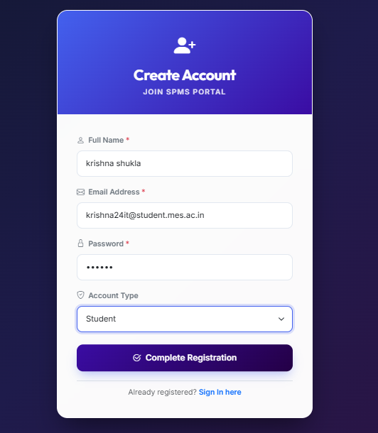
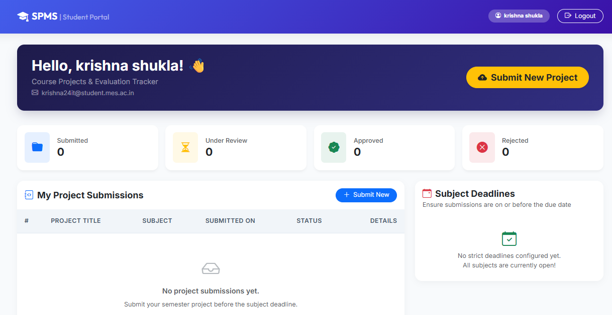
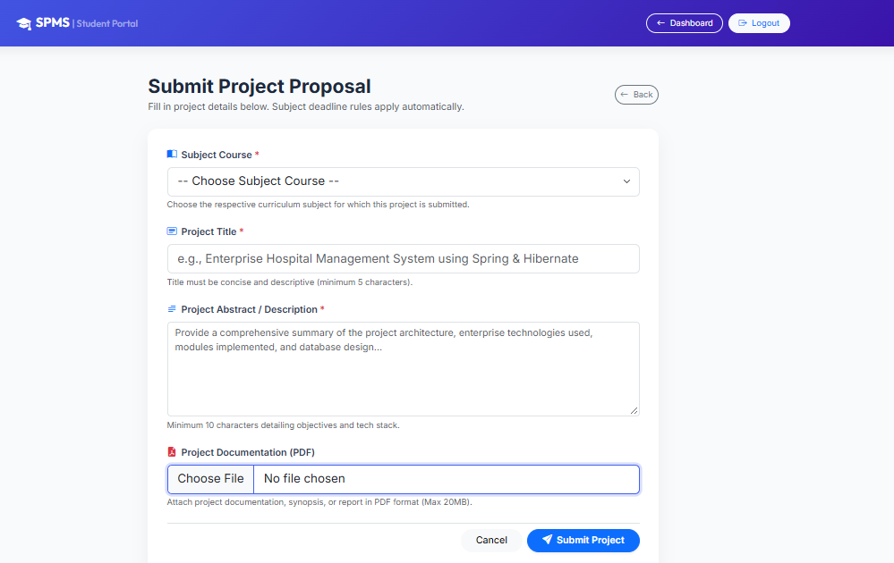
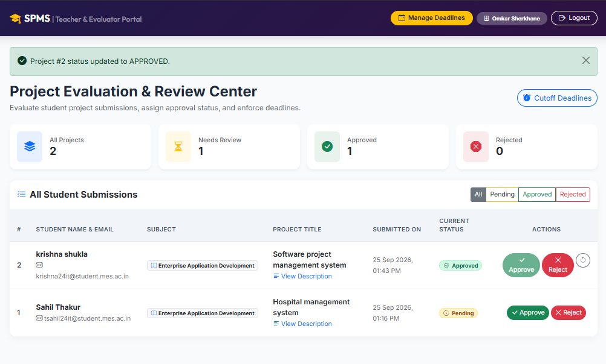
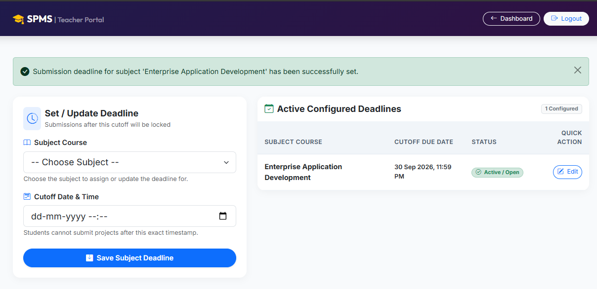

# Student Project Management System (SPMS)

An enterprise-grade web application developed with **Spring MVC 5.3**, **Hibernate ORM 5.6**, and **Embedded Apache Tomcat 9**, featuring a multi-mode database persistence engine (persistent file-based H2, MySQL, or Oracle).

[](https://render.com)

---

## 🌟 Highlights & Features

- **Role-Based Portals:** Dedicated dashboards for **Students** and **Teachers / Evaluators**.
- **Project Submissions:** Students submit title, abstract, subject classification, and PDF documentation attachments.
- **Deadline Scheduling & Automated Cutoff:** Teachers can schedule subject deadlines; submissions automatically close once deadlines pass.
- **Evaluation & Grading:** Teachers can review abstracts, download student documentation, and toggle project statuses (`APPROVED`, `REJECTED`, `PENDING`).
- **Zero-Friction Multi-Mode Database:**
  - Auto-detects running **Oracle** (port 1521) or **MySQL** (port 3306).
  - Automatically falls back to **Persistent File-Based H2 Database** with embedded web console if external servers are offline.
- **Cloud-Ready & Portable:** Boots on embedded Tomcat with automated `$PORT` binding for container platforms like **Render**, **Docker**, and **Railway**.

---

## 🔑 Demo Test Credentials

The system pre-seeds two ready-to-use accounts on first launch:

| Role | Email | Password |
|---|---|---|
| **Teacher / Evaluator** | `admin@spms.com` | `admin123` |
| **Student** | `student@spms.com` | `student123` |

*New students can also register anytime through the registration portal.*

---

## 🚀 How to Deploy on Render

1. **Fork or push this repository** to your GitHub account.
2. Sign in to [Render.com](https://render.com).
3. Click **New +** -> **Web Service**.
4. Select **Build and deploy from a Git repository** and connect this repository.
5. Set:
   - **Runtime:** `Docker`
   - **Instance Type:** `Free`
   - **Environment Variables:** `PORT=8080` (or leave default, Render sets `PORT` automatically).
6. Click **Create Web Service**.
7. Once deployed, Render will provide a public HTTPS URL (e.g. `https://spms-xxxx.onrender.com`) that you can share with anyone!

---

## 💻 Running Locally

### Option 1: Using Java & Maven
```bash
# Compile and build package
mvn clean package -DskipTests

# Start embedded Tomcat server
java -cp "target/classes;target/SPMS/WEB-INF/lib/*" com.spms.Main
```
On Linux/macOS:
```bash
java -cp "target/classes:target/SPMS/WEB-INF/lib/*" com.spms.Main
```

### Option 2: Using Docker
```bash
docker build -t spms .
docker run -p 8080:8080 spms
```

Access the application in your browser:
- **Login Portal:** `http://localhost:8080/SPMS/login` or shortcut `http://localhost:8080/`
- **H2 DB Console:** `http://localhost:8080/SPMS/h2-console`

---

## 📸 Screenshots

| Student Registration | Student Dashboard |
|---|---|
|  |  |

| Project Submission | Teacher Review Dashboard |
|---|---|
|  |  |

| Deadline Configuration |
|---|
|  |

---

## 🛠️ Technology Stack

- **Backend:** Java 17, Spring Web MVC 5.3.30, Spring ORM, Hibernate ORM 5.6.15.Final
- **Server:** Apache Tomcat Embed 9.0.85 (with Jasper JSP compiler)
- **Database:** Persistent H2 2.2.224 / MySQL 8.2 / Oracle Database 21c
- **Frontend:** JSP 2.3, JSTL 1.2, Bootstrap 5.3.3, Bootstrap Icons 1.11.3
- **Containerization:** Docker multi-stage build (Temurin JRE 17)
